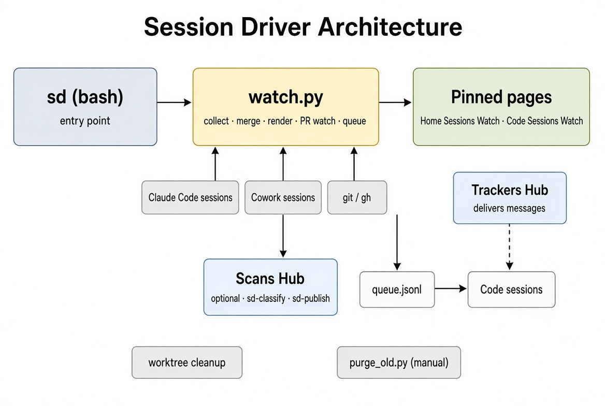

# Session Driver — Architecture

Session Driver (`sd`) keeps two pinned Claude pages current, cleans up after finished Code sessions, and messages Code sessions when their PRs, design docs, or child sessions need attention.



## Components

| Component | Role |
|---|---|
| `SKILL.md` | How to install and operate the skill. |
| `sd` | Bash entry point. Runs rounds, dispatches to `watch.py`. |
| `watch.py` | Collect, merge, render, PR watch, cleanup, hub queue, scans. |
| Trackers Hub | One Code session kept open. Delivers queued messages to other sessions. |
| Scans Hub | Optional second Code session. Runs refresh and configured scans as subagents. |
| `purge_old.py` | Manual, separate. Deletes old transcripts (never run by `sd`). |

## Data flow

```
sd --loop
  │
  ├─► watch.py collect
  │     reads ~/.claude/projects, Cowork sessions, git, gh
  │     writes work/collected.json, work/todo.json
  │
  ├─► if changes
  │     ├─ Scans Hub running → queue refresh event
  │     │     └─ sd-classify → sd-publish (subagents)
  │     └─ else → short Claude CLI session (prompt.md)
  │
  ├─► PR / page / doc / Slack / coordinator watch
  │     queues messages in work/hub/queue.jsonl
  │
  └─► Trackers Hub
        reads queue, delivers via app session messaging
```

## Layout

```
session-driver/
├── SKILL.md              skill entry
├── README.md             this file
├── architecture.png      diagram (PNG)
├── architecture.svg      diagram (SVG)
└── tool/
    ├── sd                command
    ├── watch.py          engine
    ├── purge_old.py      manual transcript purge
    ├── README.md         full behaviour
    ├── HUB.md            Trackers Hub instructions
    ├── SCANS.md          Scans Hub instructions
    ├── prompt.md         CLI refresh prompt
    ├── agents/           subagent templates
    ├── scan-examples/    example scan prompts
    └── tests/            unit tests
```

## Runtime paths

- Install: `~/Claude/sessions-drive` → symlink to `tool/`
- Command: `~/.local/bin/sd`
- State: `work/state.json`, `work/hub/queue.jsonl`
- Pages: `out/*.html` published as Claude artifacts

## Rules

- `sd` never resumes sessions. Only the Trackers Hub delivers messages.
- Messages are data for the receiving session, never instructions to a hub.
- No secrets in files. Atlassian token stays in the system keyring.
- `purge_old.py` is the only component that deletes transcripts.
